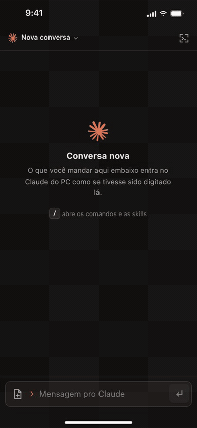

# Claude Code on your phone

Drive **Claude Code on your computer from your phone**, with everything the terminal does: the conversation, permissions, menus, attachments, files and notifications. It's a web app served by the computer itself and visible only on your private network.

[Português](README.md) · **English**

<p align="center">
  
</p>

> In the GIF, from the iPhone: I ask Claude to rewrite a shopping-cart total with `Decimal` and `ROUND_HALF_UP`, validate inputs with `ValueError`, cover the edge cases with `subTest`, run the suite and commit following Conventional Commits. I approve each command by tapping its card, and at the end I open the raw terminal screen with the diff. Everything runs on the computer, in under a minute. [Higher quality video](docs/demo.mp4). The interface is in Portuguese.

## Why not Remote Control?

Claude Code ships with [Remote Control](https://code.claude.com/docs/en/remote-control), which brings the session to the Claude app. It's official and needs no setup. This panel is for when you want full control:

| | Remote Control | This panel |
|---|---|---|
| **Where the conversation goes** | Through Anthropic's servers, which store the transcript while the session is connected | Only your computer and your Tailscale network (the model is called just like from the terminal) |
| **Who can reach it** | Whoever is on the claude.ai account | Only your Tailscale identity, even if the account is shared |
| **Supported login** | claude.ai account (Pro, Max, Team, Enterprise). No API key, Bedrock, Vertex or gateway | Any login the CLI supports |
| **Commands** | `/resume` and `/plugin` are terminal-only; `!` is sent as a message | Everything the terminal does: `/model`, `/effort`, `/rewind`, `/login`, `!`, skills, plus the raw CLI screen with keys |
| **Switching conversations** | Not from the phone; Claude must already be running on the computer | Lists conversations from any project: resume, start new, close and launch Claude |
| **Files from computer to phone** | Not documented | Claude delivers screenshots, videos, PDFs and links into the conversation, with a button to save to Photos |
| **Notifications** | Through the Claude app | Web Push in the web app itself, nothing to install; it stays quiet while you're already looking |
| **Setup** | None, built into the CLI | One script plus Tailscale |

<sub>Compared against the official Remote Control documentation in October 2026.</sub>

## Screens


## How it works


- **No changes to Claude Code:** the server reads the conversation from the `.jsonl` the CLI writes and sends prompts by pasting into tmux. Menus (permissions, `/model`, `/effort`, `/rewind`, `/login`) are parsed from the screen and answered with the same keys you'd press in the terminal.
- **Faithful to the CLI:** the interface follows the terminal instead of becoming yet another generic chat. Your message shows with `❯`, the reply with `●` and outputs with `⎿`. While Claude works, the rays of its mark move.
- **Notifications without an app:** Web Push built from scratch, with no push library. Encryption follows RFC 8291 and is checked against the RFC's own test vector; requests are signed with VAPID. The server fires them when a turn ends or a question shows up.
- **Lightweight:** the server uses only Python's standard library, and the page is plain HTML, CSS and JS with no build step. About 50 MB of RAM and under 1% of one core.

## Security

- Published with `tailscale serve`: only visible on your tailnet, never on the open internet, and no ports opened on the router.
- Every request checks the computer owner's Tailscale login and the host. Actions require a custom header and the same origin, and the server never enables CORS.
- HTML pages delivered by Claude open sandboxed (CSP `sandbox`), with no scripts and no access to the API.
- Attachments, deliveries, keys and push subscriptions stay out of git.

## Install

Requires Linux with systemd, `tmux`, `python3`, [Claude Code](https://code.claude.com) and [Tailscale](https://tailscale.com) on both the computer and the phone.

```bash
git clone https://github.com/vhbiten/claude-code-mobile
cd claude-code-mobile
./install.sh
```

The script creates the tmux session running Claude, starts the server as a user service and prints the address. On iPhone, open it in Safari and use **Share → Add to Home Screen**: notifications only work that way. To send a file to the phone, Claude runs `bin/entregar <file|folder|link>`.

## Stack

Python 3 (standard library, plus `cryptography` for push only) · framework-free JavaScript · Service Worker and Web Push · tmux · Tailscale · systemd

---

<sub>Independent project, not affiliated with Anthropic. Claude and the Claude mark belong to Anthropic. Made by [@vhbiten](https://github.com/vhbiten).</sub>
