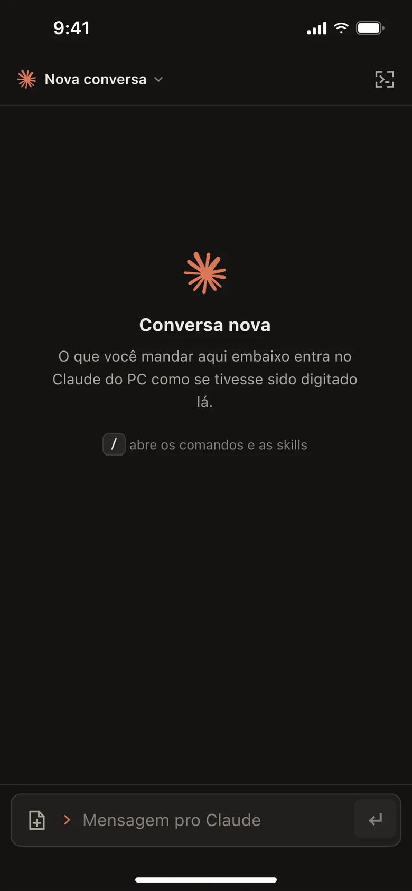
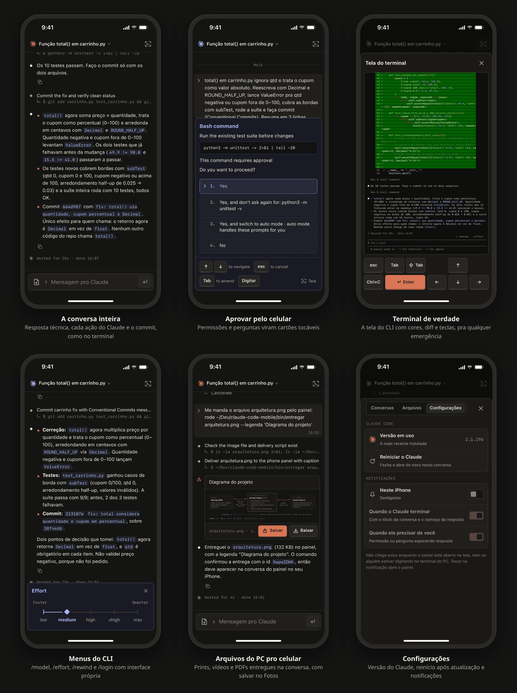
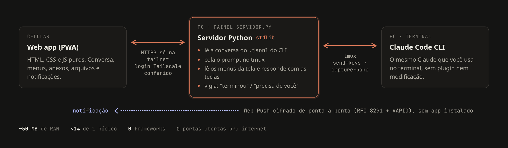

# Claude Code no celular

Comande o **Claude Code do seu PC pelo celular**, com tudo o que o terminal faz: conversa, permissões, menus, anexos, arquivos e notificações. É um web app servido pelo próprio PC e visível só na sua rede privada.

**Português** · [English](README.en.md)

<p align="center">
  
</p>

> No vídeo, pelo iPhone: peço pro Claude reescrever o cálculo de um carrinho com `Decimal` e `ROUND_HALF_UP`, validar as entradas com `ValueError`, cobrir as bordas com `subTest`, rodar a suíte e commitar no padrão Conventional Commits. Aprovo cada comando tocando no cartão; no fim, abro a tela do terminal com o diff. Tudo roda no PC, em menos de um minuto. [Vídeo em resolução de iPhone (MP4)](docs/demo.mp4).

## Por que não o Remote Control?

O Claude Code já tem o [Remote Control](https://code.claude.com/docs/en/remote-control), que leva a sessão pro app do Claude. Ele é oficial e não precisa de configuração. Este painel é pra quem quer controle total:

| | Remote Control | Este painel |
|---|---|---|
| **Por onde a conversa passa** | Pelos servidores da Anthropic, que guardam a transcrição enquanto a sessão está conectada | Só pelo seu PC e pela sua rede da Tailscale (o modelo é chamado como no terminal) |
| **Quem acessa** | Quem estiver na conta do claude.ai | Só a sua identidade na Tailscale, mesmo se a conta for compartilhada |
| **Login aceito** | Conta do claude.ai (Pro, Max, Team, Enterprise). Sem API key, Bedrock, Vertex ou gateway | Qualquer login que o CLI aceita |
| **Comandos** | `/resume` e `/plugin` só no terminal; `!` vira mensagem | Tudo do terminal: `/model`, `/effort`, `/rewind`, `/login`, `!`, skills e a própria tela do CLI com teclas |
| **Trocar de conversa** | Não pelo celular; o Claude precisa estar aberto no PC | Lista as conversas de qualquer projeto: retoma, começa nova, fecha e abre o Claude |
| **Arquivos do PC pro celular** | Não documentado | O Claude entrega prints, vídeos, PDFs e links na conversa, com botão pra salvar no Fotos |
| **Notificações** | Pelo app do Claude | Web Push no próprio web app, sem instalar nada; não avisa se você já está olhando |
| **Configuração** | Nenhuma, já vem no CLI | Um script e a Tailscale |

<sub>Comparação feita com a documentação oficial do Remote Control em outubro de 2026.</sub>

## Telas



## Como funciona



- **Sem modificar o Claude Code:** o servidor lê a conversa do `.jsonl` que o CLI grava e manda o prompt colando no tmux. Os menus (permissões, `/model`, `/effort`, `/rewind`, `/login`) são lidos da tela e respondidos com as mesmas teclas do terminal.
- **Fiel ao CLI:** a interface segue o terminal, em vez de virar mais um chat genérico. A sua mensagem aparece com `❯`, a resposta com `●` e as saídas com `⎿`. Enquanto o Claude trabalha, os raios da marca dele se mexem.
- **Notificação sem app:** Web Push feito do zero, sem biblioteca de push. A cifragem segue o RFC 8291 e foi conferida com o vetor de teste do próprio RFC; a assinatura usa VAPID. O servidor dispara quando o turno termina ou aparece uma pergunta.
- **Leve:** o servidor usa só a biblioteca padrão do Python, e a página é HTML, CSS e JS puros, sem build. Gasta cerca de 50 MB de RAM e menos de 1% de um núcleo.

## Segurança

- Publicado com `tailscale serve`: só aparece na sua tailnet, nunca na internet aberta, e nenhuma porta é aberta no roteador.
- Toda requisição confere o login da Tailscale do dono do PC e o host. Ações exigem um cabeçalho próprio e a mesma origem, e o servidor não libera CORS.
- Página HTML entregue pelo Claude abre isolada (CSP `sandbox`), sem script e sem alcançar a API.
- Anexos, entregas, chaves e inscrições de push ficam fora do git.

## Instalação

Precisa de Linux com systemd, `tmux`, `python3`, o [Claude Code](https://code.claude.com) e a [Tailscale](https://tailscale.com) no PC e no celular.

```bash
git clone https://github.com/vhbiten/claude-code-mobile
cd claude-code-mobile
./install.sh
```

O script cria a sessão do tmux com o Claude, liga o servidor como serviço do usuário e mostra o endereço. No iPhone, abra o endereço no Safari e use **Compartilhar → Adicionar à Tela de Início**: as notificações só funcionam assim. Pra mandar um arquivo pro celular, o Claude roda `bin/entregar <arquivo|pasta|link>`.

## Stack

Python 3 (biblioteca padrão, mais `cryptography` só pro push) · JavaScript sem framework · Service Worker e Web Push · tmux · Tailscale · systemd

---

<sub>Projeto independente, sem vínculo com a Anthropic. Claude e a marca do Claude pertencem à Anthropic. Feito por [@vhbiten](https://github.com/vhbiten).</sub>
